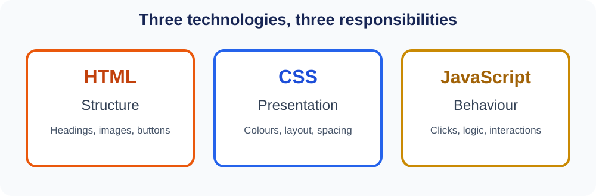
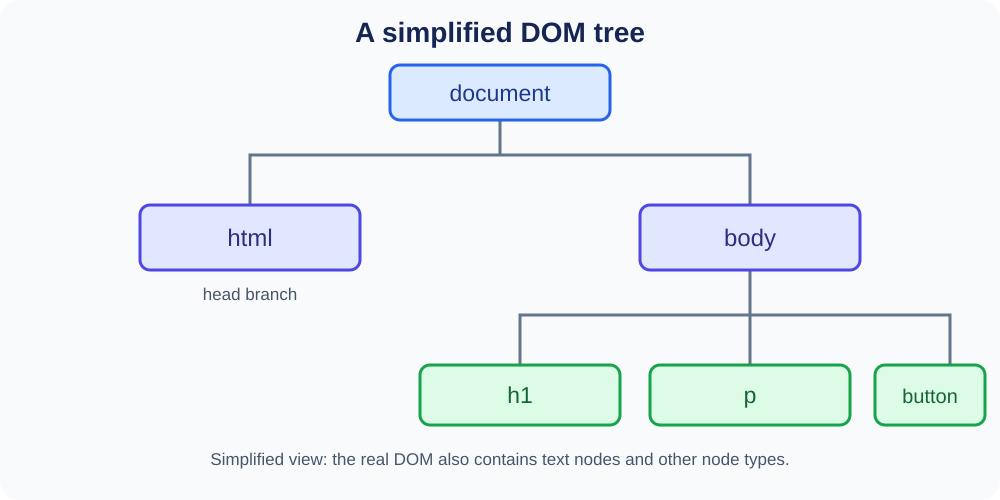
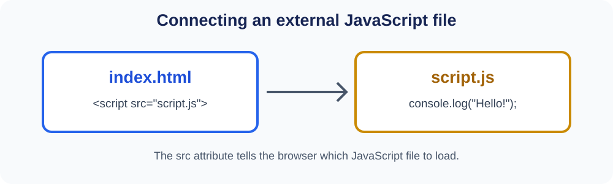

# JavaScript — Day 01
## Introduction to JavaScript and the DOM

**Code Impact Academy · Frontend Development**

---

## What will we learn?

By the end of this lesson, you should be able to:

- Explain why JavaScript is used on webpages.
- Understand the roles of HTML, CSS and JavaScript.
- Explain what the DOM is.
- Understand what `document` represents.
- Select HTML elements using `getElementById()` and `querySelector()`.
- Display output using `console.log()` and `alert()`.
- Connect an external JavaScript file.
- Make a simple webpage interaction using JavaScript.

## 1. Why do we need JavaScript?

We have already used HTML and CSS to create webpages and components. But a webpage also needs to respond when a user interacts with it.

Think about these examples:

- Clicking a button should perform an action.
- A mobile navigation menu should open and close.
- A form should check whether the entered information is valid.
- A course list should be filterable.

JavaScript helps us add this behaviour and interactivity.

**JavaScript** is a programming language used to add logic, behaviour and interactivity to webpages. It can also run outside the browser, for example with Node.js. In this course, we will first use it in the browser.

## 2. HTML, CSS and JavaScript

A simple way to remember their roles:



| Technology | Main responsibility | Examples |
|---|---|---|
| HTML | Structure | Headings, paragraphs, images, buttons |
| CSS | Presentation | Colours, spacing, layout, fonts |
| JavaScript | Behaviour | Click actions, decisions, content updates |

### Try to understand the difference

Start with a button:

```html
<button>Click Me</button>
```

HTML creates the button. CSS can make it look attractive, but styling alone does not define what should happen when it is clicked. JavaScript can add that behaviour.

```html
<script>
    alert("Welcome to JavaScript!");
</script>
```

This displays a message when the page loads.

## 3. JavaScript in the browser

A browser reads the webpage files and makes them available for display and interaction.

| Term | Meaning |
|---|---|
| Browser | Software used to open webpages |
| JavaScript engine | Software that executes JavaScript |
| DOM | The browser's structured representation of the document |
| Console | A place to view JavaScript output and errors |

For example, Google Chrome uses the **V8** JavaScript engine.

A simplified view of what happens:

1. The browser reads and parses the HTML.
2. It builds the DOM from the document.
3. It processes CSS to determine how the page should look.
4. It executes JavaScript.
5. JavaScript can interact with the page.

This is a simplified explanation. Browsers can process scripts while parsing HTML, so these steps are not always a strict sequence.

## 4. What is the DOM?

**DOM** stands for **Document Object Model**.

When the browser reads an HTML document, it creates a structured representation of that document. JavaScript can use this representation to access and work with webpage elements.

Consider this HTML:

```html
<html>
    <head>
        <title>My Page</title>
    </head>

    <body>
        <h1>Hello Students</h1>
        <p>Welcome to JavaScript</p>
        <button>Click Me</button>
    </body>
</html>
```

The browser represents the document as a tree of connected nodes.



### Important DOM terms

| Term | Meaning |
|---|---|
| Parent | An element that contains another element |
| Child | An element inside another element |
| Sibling | Elements that share the same parent |
| Root | The top-level element in the tree |
| Node | An individual item in the DOM tree |

In the example:

- `html` is the root HTML element.
- `head` and `body` are children of `html`.
- `h1`, `p` and `button` are children of `body`.
- `h1`, `p` and `button` are siblings.

**Remember:** The DOM is not the HTML source code itself. It is the browser's object-based representation of the document.

## 5. Understanding `document`

JavaScript uses the browser-provided `document` object to access the current HTML document.

```javascript
console.log(document);
```

This prints the document object in the browser console.

We can also access information about the document:

```javascript
console.log(document.title);
```

`document` represents the loaded webpage document. It is provided by the browser; we do not need to declare it ourselves.

## 6. Selecting HTML elements

Before JavaScript can work with a particular element, we need to select it.

### A. `getElementById()`

HTML:

```html
<h1 id="heading">Hello Students</h1>
```

JavaScript:

```javascript
let heading = document.getElementById("heading");

console.log(heading);
```

`getElementById()` finds an element using its `id`.

**Important:** Pass the ID without the `#` symbol.

### B. `querySelector()`

`querySelector()` selects the first element that matches a CSS selector.

HTML:

```html
<h1 id="heading">Hello Students</h1>

<p class="description">Learning JavaScript</p>

<button>Click Me</button>
```

JavaScript:

```javascript
let heading = document.querySelector("#heading");

let paragraph = document.querySelector(".description");

let button = document.querySelector("button");
```

### Common selectors

| Selector | Selects |
|---|---|
| `"h1"` | An `h1` element |
| `"#heading"` | An element with `id="heading"` |
| `".description"` | An element with `class="description"` |

### `getElementById()` vs `querySelector()`

| `getElementById()` | `querySelector()` |
|---|---|
| Selects by ID | Selects using a CSS selector |
| Pass the ID without `#` | Use `#` for an ID selector |
| Returns the matching element or `null` | Returns the first matching element or `null` |

### A quick look at `querySelectorAll()`

```javascript
let paragraphs = document.querySelectorAll("p");

console.log(paragraphs);
```

- `querySelector()` returns the first matching element.
- `querySelectorAll()` returns a collection of all matching elements.

We will work with collections of elements in more detail later.

### What if an element is not found?

```javascript
let result = document.getElementById("unknown");

console.log(result);
```

The result is `null`, which means no matching element was found.

## 7. Your first JavaScript output

### A. `console.log()`

```javascript
console.log("Hello World!");

console.log(100);

console.log(10 + 20);
```

`console.log()` prints information in the browser's developer console.

Developers commonly use it to:

- Check values.
- Test code.
- Debug problems.
- Understand what a program is doing.

### B. `alert()`

```javascript
alert("Welcome to Code Impact Academy!");
```

`alert()` displays a message in a browser dialog.

| `console.log()` | `alert()` |
|---|---|
| Displays output in the console | Displays a dialog |
| Commonly used for debugging | Useful for simple demonstrations |
| Does not interrupt normal page interaction | Must be dismissed before normal interaction continues |

`alert()` is useful for learning, but it is not the usual way to show notifications in a finished website.

### C. Comments

Comments are notes in code. JavaScript does not execute them.

```javascript
// This is a single-line comment

/*
This is a
multi-line comment
*/
```

## 8. Adding JavaScript to HTML

There are three common ways to write JavaScript in an HTML page.

### A. Inline JavaScript

JavaScript is written directly inside an HTML attribute.

```html
<button onclick="alert('Hello!')">
    Click Me
</button>
```

This is useful to recognize in examples. For larger projects, keeping JavaScript separate is easier to maintain.

### B. Internal JavaScript

JavaScript is written inside a `<script>` element in the HTML file.

```html
<!DOCTYPE html>
<html>
<body>

    <h1>Hello Students</h1>

    <script>
        console.log("JavaScript is working!");
    </script>
</body>
</html>
```

### C. External JavaScript

JavaScript is written in a separate `.js` file and connected to the HTML document.

**Folder structure:**

```text
my-project/
├── index.html
└── script.js
```

**index.html**

```html
<!DOCTYPE html>
<html>
<head>
    <title>JavaScript Introduction</title>
</head>
<body>

    <h1>Hello Students</h1>

    <script src="script.js"></script>
</body>
</html>
```

**script.js**

```javascript
console.log("External JavaScript is working!");
```



The `src` attribute tells the browser which JavaScript file to load.

### Where should the script tag go?

For our simple examples, we can put the script just before the closing `</body>` tag. This means the browser has already parsed the page elements above it.

Another option is to use `defer` in the `<head>`:

```html
<head>
    <script src="script.js" defer></script>
</head>
```

`defer` lets the browser download the external script while parsing HTML, then execute it after HTML parsing is complete.

### Comparison

| Inline | Internal | External |
|---|---|---|
| Written in an HTML attribute | Written inside `<script>` | Written in a separate `.js` file |
| Mixed with HTML | Same HTML file | Separate file |
| Avoid for normal project code | Useful for small examples | Preferred for projects |

## 9. Browser Developer Tools

Developer Tools help us inspect webpages and find problems.

### Opening Chrome DevTools

- Right-click the webpage and choose **Inspect**.
- Press `F12`.
- On Windows/Linux, `Ctrl + Shift + J` opens the Console directly in Chrome.

### Useful panels

| Panel | Purpose |
|---|---|
| Elements | Inspect HTML and CSS |
| Console | View JavaScript output and errors, and run JavaScript |
| Sources | Inspect loaded source files |

For now, focus on the **Console**.

Try these commands:

```javascript
console.log("Hello");

console.log(10 + 20);

console.warn("This is a warning");

console.error("This is an error");
```

### Understanding basic errors

| Error type | Meaning |
|---|---|
| Syntax error | The code does not follow JavaScript grammar |
| Reference error | Code refers to something that does not exist or is not accessible |
| Type error | An operation is attempted on an inappropriate value |

An error message is useful information. Read it and use it to locate the problem instead of ignoring it.

## 10. Practical: Turn a bulb ON and OFF

Let's make a webpage where clicking buttons changes a bulb image.

### What do we need?

- One image for the bulb OFF state.
- One image for the bulb ON state.
- Two buttons.
- JavaScript to select the image and change its source.

Save the two images in an `images` folder:

```text
images/
├── bulb-on.png
└── bulb-off.png
```

Use images with matching dimensions so the bulb does not jump in size when it changes.

### Step 1 — HTML

**index.html**

```html
<!DOCTYPE html>
<html>
<head>
    <title>Bulb ON/OFF</title>
</head>
<body>

    <h2>JavaScript Can Change HTML Attributes</h2>

    

    <button onclick="turnOn()">Turn ON</button>
    <button onclick="turnOff()">Turn OFF</button>

    <script src="script.js"></script>
</body>
</html>
```

### Step 2 — JavaScript

**script.js**

```javascript
function turnOn() {
    let bulb = document.getElementById("bulb");

    bulb.src = "images/bulb-on.png";
}

function turnOff() {
    let bulb = document.getElementById("bulb");

    bulb.src = "images/bulb-off.png";
}
```

### How does it work?

1. The user clicks the ON button.
2. The `turnOn()` function runs.
3. JavaScript selects the image using its ID.
4. JavaScript changes the image's `src` property.
5. The browser displays the new image.

### Try an improvement: One toggle button

After understanding the two-button version, try switching the bulb with one button.

**HTML**

```html


<button onclick="toggleBulb()">Toggle Bulb</button>
```

**JavaScript**

```javascript
let isOn = false;

function toggleBulb() {
    let bulb = document.getElementById("bulb");

    if (isOn) {
        bulb.src = "images/bulb-off.png";
        isOn = false;
    } else {
        bulb.src = "images/bulb-on.png";
        isOn = true;
    }
}
```

Here, `isOn` stores the current state:

- `false` means the bulb is OFF.
- `true` means the bulb is ON.
- The `if/else` checks the current state and changes the image.

**What this example demonstrates:** Selecting an element, changing an HTML property and responding to a click. We will study event handling in more detail in a later lesson.

## 11. Practice task: My First JavaScript Playground

Create this folder structure:

```text
day-01/
├── index.html
├── style.css
├── script.js
└── images/
    ├── bulb-on.png
    └── bulb-off.png
```

### Requirements

1. Create a heading and a paragraph.
2. Add a bulb image.
3. Add ON and OFF buttons.
4. Connect an external JavaScript file.
5. Display a welcome message using `alert()`.
6. Print a message using `console.log()`.
7. Select the heading using `getElementById()`.
8. Change the heading when a button is clicked.
9. Turn the bulb ON and OFF.

Try to understand each line instead of simply copying the code.

## 12. Quick revision questions

1. What is JavaScript, and why do webpages use it?
2. What is the difference between HTML, CSS and JavaScript?
3. What does DOM stand for?
4. What does the DOM represent?
5. What is a parent element?
6. What is the difference between a child and a sibling?
7. What does `document` represent?
8. What does `getElementById()` do?
9. What does `querySelector()` do?
10. What is the difference between `querySelector()` and `querySelectorAll()`?
11. What happens if an element cannot be found?
12. What is the difference between `console.log()` and `alert()`?
13. What are inline, internal and external JavaScript?
14. What does the `src` attribute do in a script element?
15. What is the purpose of `defer`?
16. Why do developers use the browser Console?

## 13. Homework

### Theory

1. Explain the difference between HTML, CSS and JavaScript.
2. What is JavaScript, and where can it execute?
3. What is the DOM?
4. What does `document` represent?
5. Explain the difference between `getElementById()` and `querySelector()`.
6. Explain the difference between `console.log()` and `alert()`.
7. What is the difference between inline, internal and external JavaScript?
8. What is the purpose of the `defer` attribute?
9. What happens when a DOM selection method cannot find an element?
10. Why can script placement matter?

### Practical

Create a webpage with an external JavaScript file that:

- Displays a welcome alert.
- Prints three different messages in the console.
- Selects a heading using `getElementById()`.
- Changes the heading when a button is clicked.
- Implements the bulb ON/OFF example.

Write a few lines explaining how your JavaScript works.

## 14. Remember

- **HTML** creates the structure.
- **CSS** controls the appearance.
- **JavaScript** makes the webpage respond.
- The **DOM** is the browser's structured representation of the HTML document.
- The **`document`** object gives JavaScript access to the page.
- We select elements before working with them.
- The browser Console helps us inspect output and errors.
- An external `.js` file keeps JavaScript separate from HTML.

**The goal is not just to make the bulb switch on and off. The goal is to understand how JavaScript selected the image and changed what the browser displays.**
