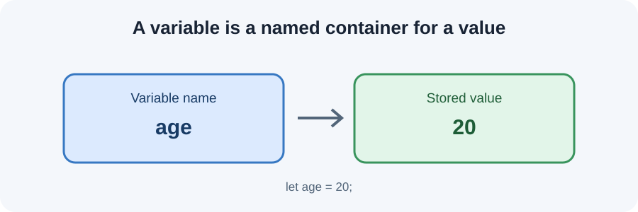
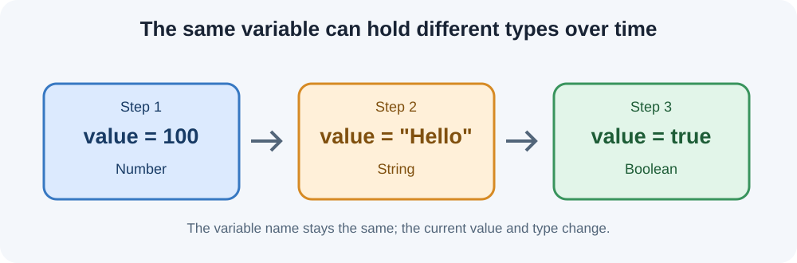
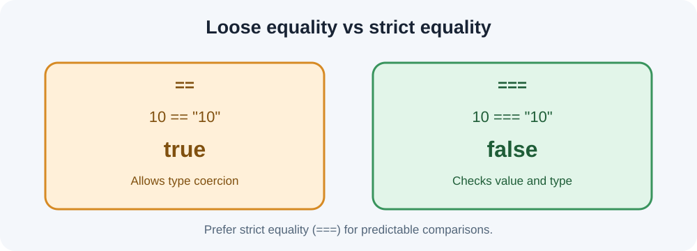

# JavaScript — Day 02
## Variables, Data Types and Operators
**Code Impact Academy · Frontend Development**

---

## 1. Learning goals

By the end of this lesson, you should be able to:
- Declare variables using `var`, `let` and `const`.
- Identify common JavaScript data types and use `typeof`.
- Explain dynamic typing.
- Convert values between types and recognise automatic type coercion.
- Use arithmetic, assignment, comparison and logical operators.
- Explain why `===` is usually preferred over `==`.

## 2. Variables

A **variable** is a named place used to store a value so that we can use it later.



```javascript
let studentName = "Aman";
let age = 20;
let isEnrolled = true;

console.log(studentName);
console.log(age);
console.log(isEnrolled);
```

`let` declares a variable. The `=` sign is the **assignment operator**: it assigns the value on the right to the variable on the left.

### Declaration and assignment

```javascript
let score;       // Declaration
score = 85;      // Assignment

let city = "Ujjain"; // Both together
```

### `var`, `let` and `const`

```javascript
var course = "Frontend";
let batch = "Morning";
const institute = "Code Impact Academy";
```

| Feature | `var` | `let` | `const` |
|---|---|---|---|
| Reassignment | Allowed | Allowed | Not allowed |
| Redeclaration in same scope | Allowed | Not allowed | Not allowed |
| Scope | Function | Block | Block |
| Must be initialized at declaration | No | No | Yes |

**Reassignment** changes the value of an existing variable.

```javascript
let age = 19;
age = 20; // Allowed

const country = "India";
country = "Japan"; // Error
```

**Redeclaration** declares the same name again in the same scope.

```javascript
var marks = 80;
var marks = 90; // Allowed

let total = 100;
let total = 200; // Error
```

**Block scope** means a variable declared inside `{ }` is available only inside that block (for `let` and `const`).

```javascript
if (true) {
    let message = "Hello";
    const count = 1;
}
// message and count cannot be accessed here
```

A useful modern rule: prefer `const` when reassignment is not needed; use `let` when it is. Understand `var` because you will see it in older code.

### Important: `const` with objects

`const` prevents reassignment of the variable, but it does not make an object's contents immutable.

```javascript
const student = { name: "Aman" };
student.name = "Riya"; // Allowed
// student = {};       // Not allowed
```

## 3. Data types

A **data type** describes the kind of value a program is working with.

| Type | Meaning | Example |
|---|---|---|
| String | Text | `"Hello"` |
| Number | Integers and decimals | `25`, `3.14` |
| Boolean | True or false | `true`, `false` |
| Undefined | Declared, but no value assigned | `let x;` |
| Null | Intentional absence of a value | `let result = null;` |
| Object | Structured/key-value data | `{ name: "Aman" }` |
| BigInt | Very large integers | `12345678901234567890n` |
| Symbol | Unique identifiers | `Symbol("id")` |

Focus on the first six for now. BigInt and Symbol are included for awareness.

### String

Text written inside single quotes, double quotes or backticks.

```javascript
let firstName = "Aman";
let city = 'Ujjain';
let message = `Welcome to JavaScript`;
```

Backticks support **template literals**, which allow variables to be inserted using `${...}`.

```javascript
let name = "Aman";
let age = 20;
console.log(`My name is ${name} and I am ${age} years old.`);
```

### Number

JavaScript uses the `Number` type for ordinary integers and decimal numbers.

```javascript
let quantity = 10;
let price = 99.50;
```

Unlike C, JavaScript does not use separate everyday types such as `int`, `float` and `double` in the same way.

### Boolean

A Boolean has only two values: `true` and `false`.

```javascript
let isLoggedIn = true;
let hasPaid = false;
```

### Undefined and null

```javascript
let phoneNumber;
console.log(phoneNumber); // undefined

let selectedCourse = null;
console.log(selectedCourse); // null
```

- `undefined`: a variable has not been assigned a value.
- `null`: we intentionally represent “no value”.

One unusual behaviour:

```javascript
console.log(typeof undefined); // "undefined"
console.log(typeof null);      // "object"
```

`typeof null` returning `"object"` is a historical JavaScript behaviour. It does not mean `null` is actually an object.

### Object

An object groups related information as key-value pairs.

```javascript
let student = {
    name: "Aman",
    age: 20,
    course: "Frontend"
};

console.log(student.name);
console.log(student.age);
```

We will study objects in detail later.

## 4. The `typeof` operator

`typeof` returns a string describing the type of a value.

```javascript
console.log(typeof "Hello"); // "string"
console.log(typeof 25);      // "number"
console.log(typeof true);    // "boolean"

let result;
console.log(typeof result);  // "undefined"

console.log(typeof "100");   // "string"
console.log(typeof 100);     // "number"
console.log(typeof null);    // "object" (historical quirk)
```

## 5. Dynamic typing

In JavaScript, a variable is not permanently restricted to one data type. Its current value determines its current type.

```javascript
let value = 100;
console.log(typeof value); // number

value = "Hello";
console.log(typeof value); // string

value = true;
console.log(typeof value); // boolean
```



JavaScript still has data types. “Dynamic” means the variable is not permanently declared as one specific type.

## 6. Type conversion

**Type conversion** means deliberately converting a value from one type to another. Common conversion functions are `Number()`, `String()` and `Boolean()`.

### String to Number

```javascript
let value = "150";
let numberValue = Number(value);

console.log(numberValue);        // 150
console.log(typeof numberValue); // "number"
```

### Number to String

```javascript
let price = 250;
let textPrice = String(price);

console.log(textPrice);        // "250"
console.log(typeof textPrice); // "string"
```

### Conversion to Boolean

```javascript
console.log(Boolean(1));       // true
console.log(Boolean(0));       // false
console.log(Boolean("Hello")); // true
console.log(Boolean(""));      // false
```

| Original value | Conversion | Result |
|---|---|---|
| `"25"` | `Number("25")` | `25` |
| `"hello"` | `Number("hello")` | `NaN` |
| `100` | `String(100)` | `"100"` |
| `1` | `Boolean(1)` | `true` |
| `0` | `Boolean(0)` | `false` |
| `""` | `Boolean("")` | `false` |

`NaN` means **Not-a-Number**. It is a special numeric value produced when a numeric operation cannot produce a valid number.

```javascript
let result = Number("hello");
console.log(result);        // NaN
console.log(typeof result); // "number"
```

## 7. Type coercion

**Type coercion** is automatic type conversion performed by JavaScript while evaluating an expression.

- **Conversion:** we explicitly request it, such as `Number("50")`.
- **Coercion:** JavaScript converts a value automatically as part of an operation.

```javascript
console.log("10" + 5); // "105"
console.log("10" - 5); // 5
console.log("10" * 5); // 50
```

Why?
- With `+`, a string can cause concatenation (joining text).
- With `-` and `*`, JavaScript converts numeric strings to numbers for the calculation.

```javascript
console.log(10 + "20"); // "1020"
console.log(10 - "5");  // 5
console.log(true + 1);  // 2
console.log(false + 1); // 1
```

Do not memorise every possible coercion case. Recognise that automatic conversion happens, and use explicit conversion when it makes your code clearer.

## 8. Operators

An **operator** performs an operation on one or more values. In `10 + 5`, `+` is the operator and `10`, `5` are operands.

### Arithmetic operators

| Operator | Meaning | Example | Result |
|---|---|---|---|
| `+` | Addition | `10 + 5` | `15` |
| `-` | Subtraction | `10 - 5` | `5` |
| `*` | Multiplication | `10 * 5` | `50` |
| `/` | Division | `10 / 5` | `2` |
| `%` | Remainder | `10 % 3` | `1` |
| `**` | Exponentiation | `2 ** 3` | `8` |
| `++` | Increment by 1 | `x++` | increases `x` |
| `--` | Decrement by 1 | `x--` | decreases `x` |

`%` returns the remainder; it does not calculate a percentage.

```javascript
let a = 10;
let b = 3;

console.log(a + b);
console.log(a % b);
console.log(a ** b);
```

### Assignment operators

```javascript
let score = 10;

score += 5; // score = score + 5
score -= 2; // score = score - 2
score *= 3; // score = score * 3
score /= 2; // score = score / 2
```

| Operator | Example | Equivalent |
|---|---|---|
| `=` | `x = 10` | Assign 10 to x |
| `+=` | `x += 5` | `x = x + 5` |
| `-=` | `x -= 5` | `x = x - 5` |
| `*=` | `x *= 5` | `x = x * 5` |
| `/=` | `x /= 5` | `x = x / 5` |
| `%=` | `x %= 5` | `x = x % 5` |

### Comparison operators

Comparison operators produce a Boolean result (`true` or `false`).

| Operator | Meaning |
|---|---|
| `==` | Equal after allowing type coercion |
| `===` | Strict equality: value and type match |
| `!=` | Not equal after allowing type coercion |
| `!==` | Strict inequality |
| `>` | Greater than |
| `<` | Less than |
| `>=` | Greater than or equal to |
| `<=` | Less than or equal to |

```javascript
console.log(10 > 5);   // true
console.log(10 < 5);   // false
console.log(10 >= 10); // true
```

### `==` vs `===`

```javascript
console.log(10 == "10");  // true
console.log(10 === "10"); // false
```

- `==` allows type coercion before comparing.
- `===` compares without converting the types first.



Prefer `===` and `!==` in normal JavaScript code because they make comparisons more predictable.

### Logical operators

Logical operators combine or reverse Boolean expressions.

| Operator | Name | Meaning |
|---|---|---|
| `&&` | AND | Both sides must be true |
| `\|\|` | OR | At least one side must be true |
| `!` | NOT | Reverses true/false |

```javascript
let hasId = true;
let hasTicket = false;

console.log(hasId && hasTicket); // false
console.log(hasId || hasTicket); // true
console.log(!hasId);             // false
```

Read them as:
- `A && B`: A **and** B must both be true.
- `A || B`: A **or** B must be true.
- `!A`: not A.

We will use these with conditions in the next lesson.

## 9. Operator precedence

When an expression has multiple operators, precedence decides which operation happens first.

```javascript
let result = 10 + 5 * 2;
console.log(result); // 20
```

Multiplication happens before addition. Parentheses can make the intended order clear:

```javascript
let result = (10 + 5) * 2;
console.log(result); // 30
```

You do not need to memorise a large precedence table now. Use parentheses to make complex expressions readable.

## 10. Practical examples

### Example 1 — Student information

```javascript
const studentName = "Aman";
let age = 20;
const course = "Frontend Development";
let isEnrolled = true;

console.log("Name:", studentName);
console.log("Age:", age);
console.log("Course:", course);
console.log("Enrolled:", isEnrolled);
```

### Example 2 — Total and percentage calculator

```javascript
let subject1 = 80;
let subject2 = 75;
let subject3 = 90;
let subject4 = 85;
let subject5 = 70;

let total = subject1 + subject2 + subject3 + subject4 + subject5;
let percentage = (total / 500) * 100;

console.log("Total:", total);
console.log("Percentage:", percentage);
```

### Example 3 — Shopping bill

```javascript
let itemPrice = 250;
let quantity = 3;

let totalBill = itemPrice * quantity;
let discount = 50;
let finalBill = totalBill - discount;

console.log("Total:", totalBill);
console.log("Discount:", discount);
console.log("Final bill:", finalBill);
```

### Example 4 — Output prediction

Predict each output before running the code.

```javascript
console.log(5 + 3);
console.log("5" + 3);
console.log("5" - 3);
console.log(5 == "5");
console.log(5 === "5");
console.log(true + 1);
```

## 11. Common mistakes

**1. Confusing assignment and comparison**

```javascript
let age = 20; // Assignment
```
`=` assigns. `==` and `===` compare.

**2. Forgetting quotes around text**

```javascript
let name = "Aman";
```
Without quotes, JavaScript treats `Aman` as an identifier, not text.

**3. Reassigning a `const` variable**

```javascript
const pi = 3.14;
pi = 3.14159; // Error
```

**4. Assuming `+` always adds numbers**

```javascript
console.log("10" + 5); // "105"
```

**5. Assuming `typeof null` returns `"null"`**

```javascript
console.log(typeof null); // "object"
```

## 12. Practice exercises

Try these without copying the examples.

### Exercise 1 — Personal details
Create variables for your name, age, city, course and whether you are a student. Print each value and its type.

### Exercise 2 — Marks calculator
Store marks for five subjects. Calculate total marks and percentage (each subject is out of 100).

### Exercise 3 — Shopping bill
Store an item's price and quantity. Calculate the total, subtract a discount and print the final bill.

### Exercise 4 — Type conversion
Create a variable containing `"250"`. Convert it to a number, add `50`, and print the result and its type.

### Exercise 5 — Predict the output
Write down your predictions before running this code.

```javascript
console.log(20 + "5");
console.log(20 - "5");
console.log("10" * "2");
console.log(true + 2);
console.log(typeof "100");
console.log(typeof null);
```

### Exercise 6 — Equality check
Predict and explain each result.

```javascript
console.log(10 == "10");
console.log(10 === "10");
console.log(0 == false);
console.log(0 === false);
```

### Exercise 7 — Update a balance
Create `balance` with an initial value of `1000`. Add `500`, subtract `200`, and print the final value using compound assignment operators.

## 13. Quick revision questions

1. What is a variable?
2. What is the difference between declaration and assignment?
3. What is the difference between `var`, `let` and `const`?
4. What is a data type?
5. What does `typeof` do?
6. What is dynamic typing?
7. What is the difference between `undefined` and `null`?
8. What is the difference between type conversion and type coercion?
9. What does `NaN` mean?
10. What is the difference between `==` and `===`?
11. What is the difference between `=` and `+=`?
12. What do `&&`, `||` and `!` do?

## 14. Homework

1. Store a student's name, age and marks, then print them.
2. Calculate the total and percentage of five subjects.
3. Create a bill calculator using price, quantity and discount.
4. Write five examples of explicit type conversion.
5. Predict and explain the output of:
   - `10 + "20"`
   - `10 - "5"`
   - `true + 1`
   - `10 == "10"`
   - `10 === "10"`

---

## Lesson summary

- Variables store values for later use.
- Prefer `const` when reassignment is unnecessary; use `let` when a value must change.
- JavaScript includes String, Number, Boolean, Undefined, Null and Object types.
- `typeof` helps identify the type of a value.
- JavaScript is dynamically typed: a variable can hold values of different types over time.
- Type conversion is explicit; type coercion is automatic.
- Operators perform arithmetic, assignment, comparison and logical operations.
- Prefer `===` and `!==` for predictable comparisons.

**Next lesson:** Conditional Statements — `if`, `else`, `else if`, `switch` and the ternary operator.
