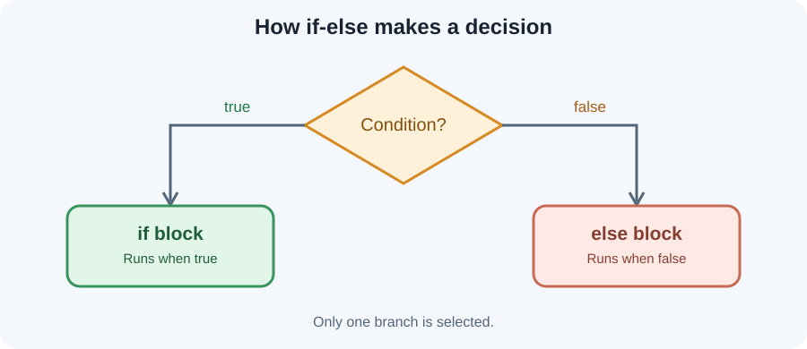
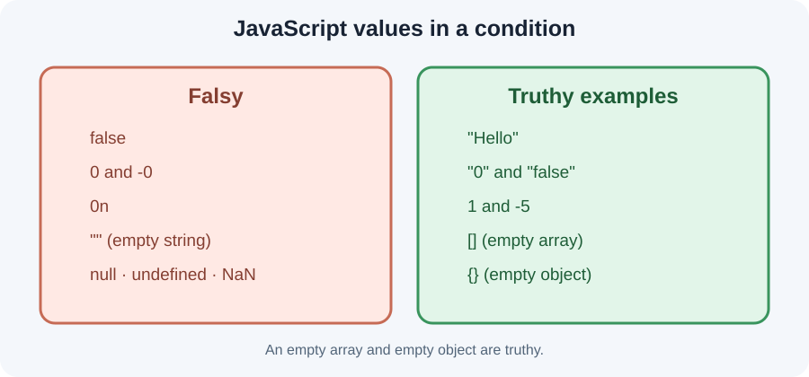

# JavaScript — Day 03
## Conditional Statements
**Code Impact Academy · Frontend Development**

---

## 1. Learning goals

Programs often need to make decisions. For example, a student passes if their marks meet the required score, or a login succeeds if the credentials are correct.

**Conditional statements** allow a program to choose which code to execute based on a condition.

By the end of this lesson, you should be able to:
- Use `if`, `if-else` and `else-if`.
- Write nested conditions.
- Use `switch` for multiple fixed choices.
- Use the ternary operator for simple decisions.
- Understand truthy and falsy values in JavaScript.

## 2. The `if` statement

The `if` statement executes a block only when its condition evaluates to `true`.

```javascript
if (condition) {
    // Runs when condition is true
}
```

Example:

```javascript
let age = 20;

if (age >= 18) {
    console.log("You are eligible to vote.");
}
```

Since `age >= 18` is true, the message is printed. If the condition is false, the block is skipped.

```javascript
let age = 15;

if (age >= 18) {
    console.log("Eligible");
}

console.log("Program ended.");
```

Output:
```text
Program ended.
```

## 3. The `if-else` statement

Use `if-else` when the program must choose between two paths.

```javascript
if (condition) {
    // Runs when true
} else {
    // Runs when false
}
```

Example:

```javascript
let marks = 35;

if (marks >= 40) {
    console.log("Pass");
} else {
    console.log("Fail");
}
```

Output: `Fail`

Only one of the two blocks runs.



## 4. The `else-if` ladder

Use an `else-if` ladder when there are more than two possible outcomes.

```javascript
if (condition1) {
    // First condition is true
} else if (condition2) {
    // Second condition is true
} else if (condition3) {
    // Third condition is true
} else {
    // None matched
}
```

JavaScript checks conditions from top to bottom. The first true condition runs; the remaining branches are skipped.

Example — grade calculator:

```javascript
let marks = 82;

if (marks >= 90) {
    console.log("Grade A");
} else if (marks >= 75) {
    console.log("Grade B");
} else if (marks >= 60) {
    console.log("Grade C");
} else if (marks >= 40) {
    console.log("Grade D");
} else {
    console.log("Fail");
}
```

Output: `Grade B`

**Order matters.** If you check `marks >= 40` first, a score of 82 will match it and receive Grade D. In this example, check higher thresholds first.

## 5. Nested `if-else`

A nested condition is an `if` or `if-else` statement placed inside another conditional statement. It is useful when one decision depends on another.

Example — login check:

```javascript
let username = "admin";
let password = "12345";

if (username === "admin") {
    if (password === "12345") {
        console.log("Login successful");
    } else {
        console.log("Incorrect password");
    }
} else {
    console.log("User not found");
}
```

The password check runs only if the username condition is true.

Avoid unnecessary nesting. Too many levels make code harder to read. Sometimes logical operators make the same logic clearer.

## 6. The `switch` statement

Use `switch` when comparing one expression against several fixed values.

```javascript
switch (expression) {
    case value1:
        // Code for value1
        break;

    case value2:
        // Code for value2
        break;

    default:
        // No case matched
}
```

Example — day number:

```javascript
let day = 3;

switch (day) {
    case 1:
        console.log("Monday");
        break;
    case 2:
        console.log("Tuesday");
        break;
    case 3:
        console.log("Wednesday");
        break;
    case 4:
        console.log("Thursday");
        break;
    default:
        console.log("Invalid day");
}
```

Output: `Wednesday`

### Why use `break`?

`break` exits the `switch`. Without it, execution continues into the following case. This is called **fall-through**.

```javascript
let choice = 1;

switch (choice) {
    case 1:
        console.log("One");
    case 2:
        console.log("Two");
        break;
}
```

Output:
```text
One
Two
```

There is no `break` after `case 1`, so execution continues into `case 2`.

### The `default` case

`default` runs when no case matches. It is optional, but useful for handling unexpected values.

### Important: `switch` uses strict comparison

JavaScript compares the switch expression with each case using strict equality (`===`).

```javascript
let value = "2";

switch (value) {
    case 2:
        console.log("Number two");
        break;
    case "2":
        console.log("String two");
        break;
}
```

Output: `String two`

The number `2` and string `"2"` have different types, so they do not match.

## 7. The ternary operator

The **ternary operator** is a shorter way to write a simple `if-else` decision. It has three parts: a condition, a result for true, and a result for false.

```javascript
condition ? valueIfTrue : valueIfFalse;
```

Example:

```javascript
let age = 20;
let result = age >= 18 ? "Adult" : "Minor";

console.log(result); // Adult
```

The same decision using `if-else`:

```javascript
let age = 20;
let result;

if (age >= 18) {
    result = "Adult";
} else {
    result = "Minor";
}
```

Use ternary for short, simple decisions. If the logic becomes complicated or difficult to read, use `if-else`.

## 8. Truthy and falsy values

This is an important JavaScript concept, especially when moving from C.

A condition does not have to contain an expression that explicitly returns `true` or `false`. JavaScript converts the value to a Boolean when evaluating it.

- **Truthy:** behaves like `true` in a condition.
- **Falsy:** behaves like `false` in a condition.

### Falsy values

These values are falsy:
- `false`
- `0`, `-0` and `0n`
- `""` (empty string)
- `null`
- `undefined`
- `NaN`

Example:

```javascript
let username = "";

if (username) {
    console.log("Username is available");
} else {
    console.log("Username is empty");
}
```

Output: `Username is empty`

An empty string is falsy, so the `else` block runs.

### Truthy values

Everything not in the falsy list is truthy. Examples:

```javascript
if ("Hello") {
    console.log("This runs");
}

if (100) {
    console.log("This also runs");
}

if ("0") {
    console.log("A non-empty string is truthy");
}

if ([]) {
    console.log("An empty array is truthy");
}

if ({}) {
    console.log("An empty object is truthy");
}
```

All five blocks run.



**Important:** An empty string `""` is falsy, but an empty array `[]` and an empty object `{}` are truthy.

You can check conversions explicitly:

```javascript
console.log(Boolean(0));       // false
console.log(Boolean(1));       // true
console.log(Boolean(""));      // false
console.log(Boolean("Hello")); // true
console.log(Boolean([]));      // true
console.log(Boolean(null));    // false
```

### Truthy/falsy is not the same as valid/invalid

A value being truthy does not mean it is valid.

```javascript
let age = -5;

if (age) {
    console.log("A value was provided");
}
```

This runs because `-5` is truthy. But a negative age is not valid input for most applications.

Validate using the actual rule:

```javascript
if (age >= 0 && age <= 120) {
    console.log("Valid age");
} else {
    console.log("Invalid age");
}
```

## 9. Combining conditions with logical operators

You learned these operators in Day 02. Now use them inside conditions.

| Operator | Meaning |
|---|---|
| `&&` | AND — both conditions must be true |
| `\|\|` | OR — at least one condition must be true |
| `!` | NOT — reverses a Boolean value |

### AND (`&&`)

```javascript
let age = 22;
let hasId = true;

if (age >= 18 && hasId) {
    console.log("Entry allowed");
} else {
    console.log("Entry denied");
}
```

Both conditions must be true.

### OR (`||`)

```javascript
let isWeekend = false;
let isHoliday = true;

if (isWeekend || isHoliday) {
    console.log("No classes today");
}
```

At least one condition must be true.

### NOT (`!`)

```javascript
let isLoggedIn = false;

if (!isLoggedIn) {
    console.log("Please log in");
}
```

`!` reverses the Boolean value.

## 10. Practical programs

### Example 1 — Even or odd

```javascript
let number = 17;

if (number % 2 === 0) {
    console.log("Even number");
} else {
    console.log("Odd number");
}
```

### Example 2 — Positive, negative or zero

```javascript
let number = -8;

if (number > 0) {
    console.log("Positive");
} else if (number < 0) {
    console.log("Negative");
} else {
    console.log("Zero");
}
```

### Example 3 — Largest of three numbers

```javascript
let a = 25;
let b = 40;
let c = 15;

if (a >= b && a >= c) {
    console.log("A is largest");
} else if (b >= a && b >= c) {
    console.log("B is largest");
} else {
    console.log("C is largest");
}
```

This version handles ties by selecting the first matching branch.

### Example 4 — Calculator using `switch`

```javascript
let a = 20;
let b = 5;
let operator = "*";

switch (operator) {
    case "+":
        console.log(a + b);
        break;
    case "-":
        console.log(a - b);
        break;
    case "*":
        console.log(a * b);
        break;
    case "/":
        if (b !== 0) {
            console.log(a / b);
        } else {
            console.log("Cannot divide by zero");
        }
        break;
    default:
        console.log("Invalid operator");
}
```

### Example 5 — Login validation

```javascript
let username = "student";
let password = "learn123";

if (username === "student" && password === "learn123") {
    console.log("Welcome!");
} else {
    console.log("Invalid username or password");
}
```

These examples use fixed values to focus on conditions. Input from HTML forms and browser events will be covered in the DOM section.

## 11. Common mistakes

### Mistake 1 — Using `=` instead of comparison

```javascript
let age = 20;

if (age = 18) {
    console.log("Condition ran");
}
```

This assigns `18` to `age`; it does not compare the age with 18. Use `===` or another comparison operator when you mean to compare.

### Mistake 2 — Forgetting braces

Use braces consistently, even when the block contains only one statement.

```javascript
if (age >= 18) {
    console.log("Adult");
}
```

### Mistake 3 — Wrong order in an `else-if` ladder

Check higher grade boundaries before lower ones. Otherwise, a broad condition may match too early.

### Mistake 4 — Forgetting `break`

Without `break`, execution may continue into later `switch` cases.

### Mistake 5 — Thinking an empty array is falsy

```javascript
if ([]) {
    console.log("This runs");
}
```

An empty array is truthy in JavaScript.

### Mistake 6 — Treating truthiness as validation

A non-empty string such as `"hello"` is truthy. That does not prove it is valid input.

## 12. Practice exercises

Try each problem yourself before looking at the examples above.

1. **Even or odd:** Check whether a number is even or odd.
2. **Voting eligibility:** Check whether a person's age is at least 18.
3. **Grade calculator:** Display a grade using an `else-if` ladder.
4. **Largest of three:** Find the largest of three numbers.
5. **Menu calculator:** Use `switch` to perform addition, subtraction, multiplication or division.
6. **Login check:** Check a username and password using `&&`.
7. **Truthy or falsy:** Predict whether each value enters an `if` block: `0`, `"0"`, `""`, `"false"`, `null`, `[]`, `{}`, `NaN`.
8. **Ternary practice:** Store a number and use ternary to create a variable containing `"Positive"` or `"Not positive"`.

## 13. Quick revision questions

1. What is a conditional statement?
2. When would you use `if-else` instead of only `if`?
3. How does an `else-if` ladder execute?
4. What is a nested `if` statement?
5. When is `switch` useful?
6. Why is `break` used in a `switch`?
7. What happens if `break` is omitted?
8. What is the ternary operator?
9. What is the difference between truthy and falsy values?
10. Is an empty array falsy in JavaScript?
11. What is the difference between truthiness and input validation?
12. What do `&&`, `||` and `!` mean?

## 14. Homework

1. Write a program to check whether a number is positive, negative or zero.
2. Write a program to calculate a student's grade using marks.
3. Write a program to find the largest of three numbers.
4. Create a calculator using `switch`.
5. Write a login check using `&&`.
6. Predict the output without running the code:

```javascript
console.log(Boolean(0));
console.log(Boolean("0"));
console.log(Boolean(""));
console.log(Boolean("false"));
console.log(Boolean([]));
console.log(Boolean({}));
console.log(Boolean(null));
console.log(Boolean(NaN));
```

7. Rewrite a simple `if-else` assignment using the ternary operator.

---

## Lesson summary

- Conditional statements let a program choose which code to execute.
- `if` runs code when a condition is true.
- `if-else` provides two paths.
- `else-if` handles multiple conditions in order.
- Nested conditions place one decision inside another.
- `switch` compares one expression against multiple cases; `break` prevents unwanted fall-through.
- Ternary is useful for short, simple decisions.
- JavaScript converts values to Boolean when evaluating conditions.
- Empty strings and zero are falsy; empty arrays and empty objects are truthy.
- Truthiness is not the same as input validation.

**Next lesson:** Loops — `for`, `while`, `do-while`, `break`, `continue` and `for...of`.
